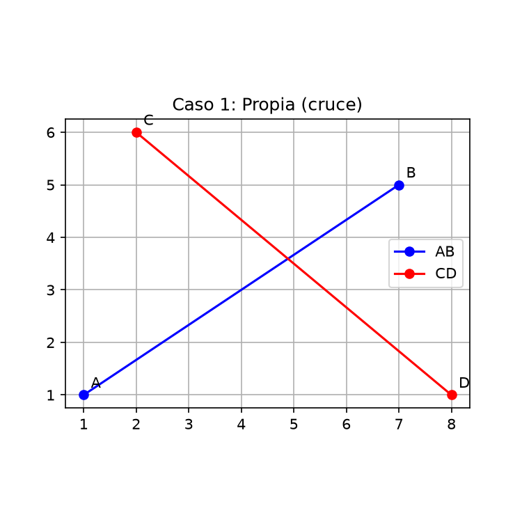
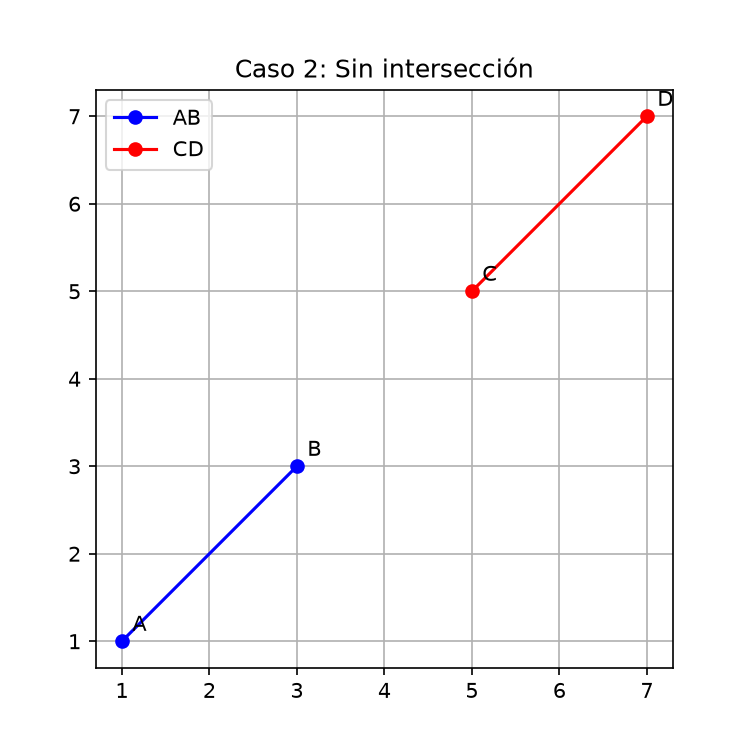
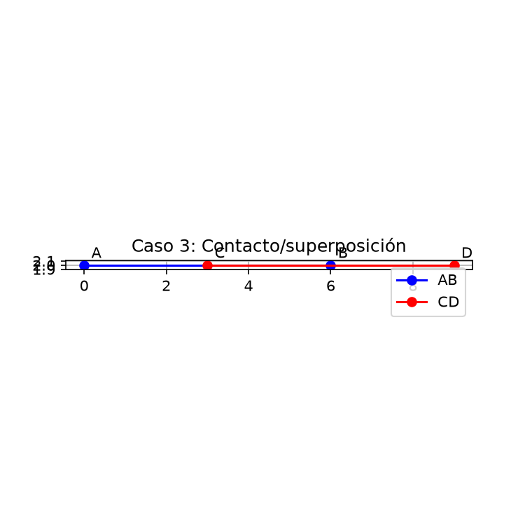
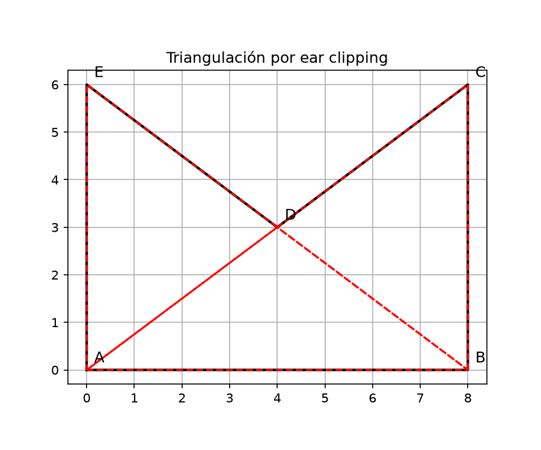

# Geometría computacional: robots, tuberías y triangulación

Autor: Andrés — Ingeniería de Sistemas, UFPSO

## Cómo ejecutar

    pip install -r requirements.txt
    python src/ejercicio1.py
    python src/ejercicio2.py   # genera docs/caso1.png, caso2.png, caso3.png
    python src/ejercicio3.py
    python src/ejercicio4.py   # genera docs/triangulacion.png
    python src/ejercicio5.py

---

## Ejercicio 1: Orientación de tres puntos

Fórmula: `det = (Bx − Ax)(Cy − Ay) − (By − Ay)(Cx − Ax)`

- det > 0: giro antihorario
- det < 0: giro horario
- det = 0: colineal

| Caso | Puntos | det | Clasificación |
|---|---|---|---|
| 1 | A(1,2) B(5,3) C(3,7) | 18 | Antihorario |
| 2 | A(2,1) B(6,5) C(8,2) | -20 | Horario |
| 3 | A(1,1) B(3,3) C(6,6) | 0 | Colineal |
| 4 | A(0,4) B(5,4) C(3,1) | -15 | Horario |

**T(n):** cada determinante usa 7 operaciones aritméticas y 1 comparación,
es decir T = 8, constante, por lo que es **O(1)**. Para n ternas, T(n) = 8n, que es **O(n)**.

---

## Ejercicio 2: Intersección de segmentos

Se calculan o1 = orient(A,B,C), o2 = orient(A,B,D), o3 = orient(C,D,A), o4 = orient(C,D,B).
Hay intersección propia si o1·o2 < 0 y o3·o4 < 0. Si alguna orientación es 0,
se verifica si el punto está dentro del bounding box del otro segmento.

| Caso | o1 | o2 | o3 | o4 | ¿Intersecta? | Tipo |
|---|---|---|---|---|---|---|
| 1: AB(1,1)-(7,5), CD(2,6)-(8,1) | +26 | -28 | -35 | +19 | Sí | Propia, en (4.89, 3.59) |
| 2: (1,1)-(3,3), (5,5)-(7,7) | 0 | 0 | 0 | 0 | No | Colineales disjuntos |
| 3: (0,2)-(6,2), (3,2)-(9,2) | 0 | 0 | 0 | 0 | Sí | Superposición en [3,6] |

Gráficas:





**¿Por qué es O(1)?** Siempre se calculan 4 orientaciones (8 operaciones cada una),
un número fijo de comparaciones de signo y a lo sumo 4 verificaciones de rango.
No hay ciclos ni recursión que dependan del tamaño de la entrada (siempre son 4 puntos),
por lo tanto T(n) = c, es decir O(1).

---

## Ejercicio 3: Tuberías que se intersectan

**Función `intersecta`:** recibe dos segmentos y devuelve `True` si se cruzan, se tocan
o se superponen. Usa las 4 orientaciones del Ejercicio 2, por lo que cada llamada es O(1).

```python
for i in range(n):
    for j in range(i + 1, n):
        if intersecta(tub[i], tub[j]):
            guardar(i, j)
```

**¿Por qué el segundo `for` empieza en `i+1`?**
1. Evita comparar una tubería consigo misma.
2. Evita pares repetidos, porque intersecta(i,j) = intersecta(j,i).
3. Reduce las llamadas de n² a n(n−1)/2.

**Tabla n = 5**

| i | j | Llamadas | Acumulado |
|---|---|---|---|
| 0 | 1..4 | 4 | 4 |
| 1 | 2..4 | 3 | 7 |
| 2 | 3..4 | 2 | 9 |
| 3 | 4 | 1 | 10 |
| 4 | - | 0 | **10** |

**Tabla n = 8**

| i | j | Llamadas | Acumulado |
|---|---|---|---|
| 0 | 1..7 | 7 | 7 |
| 1 | 2..7 | 6 | 13 |
| 2 | 3..7 | 5 | 18 |
| 3 | 4..7 | 4 | 22 |
| 4 | 5..7 | 3 | 25 |
| 5 | 6..7 | 2 | 27 |
| 6 | 7 | 1 | 28 |
| 7 | - | 0 | **28** |

**Expresión exacta:**

    T(n) = (n-1) + (n-2) + ... + 1 + 0 = n(n-1)/2 = (n² − n)/2

Comprobación: n=5 → 10, n=8 → 28.

**Complejidad temporal:** T(n) = ½n² − ½n ∈ **Θ(n²)**.

| n | Comprobaciones n(n−1)/2 |
|---|---|
| 100 | 4 950 |
| 1 000 | 499 500 |
| 10 000 | 49 995 000 |

Al multiplicar n por 10, las comprobaciones se multiplican por ~100.

---

## Ejercicio 4: Terreno irregular

Vértices: A(0,0), B(8,0), C(8,6), D(4,3), E(0,6).
Área con signo (shoelace) = 36 > 0, por lo que el polígono está en sentido antihorario.

**1. Vértices convexos y cóncavos**

| Vértice | Terna | det | Tipo |
|---|---|---|---|
| A | E, A, B | 48 | Convexo |
| B | A, B, C | 48 | Convexo |
| C | B, C, D | 24 | Convexo |
| D | C, D, E | -24 | **Cóncavo** |
| E | D, E, A | 24 | Convexo |

**2. Triángulos y diagonales (n = 5):** n − 2 = **3 triángulos** y n − 3 = **2 diagonales internas**.

**3. Triangulación válida:** diagonales D–A y D–B.

| Triángulo | Área |
|---|---|
| ABD | 12 |
| BCD | 12 |
| ADE | 12 |
| Total | 36 (igual al área del terreno) |



**4. Primera oreja:** el vértice **C** (triángulo BCD, diagonal B–D).
A y B no son orejas porque D queda sobre un lado de sus triángulos (se trata como dentro).
Después sale B (triángulo ABD) y queda el triángulo ADE.

**5. Condiciones antes de retirar un vértice**
1. Debe ser convexo (det > 0 en un polígono antihorario).
2. Ningún otro vértice debe estar dentro del triángulo (anterior, actual, siguiente).
3. La diagonal (anterior, siguiente) debe quedar dentro del polígono sin cruzar aristas.
4. El polígono debe ser simple y tener más de 3 vértices.

**6. Código:** ver `src/ejercicio4.py`, función `conteo_triangulacion(n)`, que devuelve (n−2, n−3).

---

## Ejercicio 5: Videojuegos (Ta vs Tb)

- **Algoritmo A:** ear clipping con listas de vértices convexos/cóncavos. Ta(n) = n².
- **Algoritmo B:** fuerza bruta (probar todas las diagonales contra todas las aristas). Tb(n) = n³.

| n | Ta = n² | Tb = n³ | Tb/Ta |
|---|---|---|---|
| 5 | 25 | 125 | 5 |
| 8 | 64 | 512 | 8 |
| 10 | 100 | 1 000 | 10 |
| 100 | 10 000 | 1 000 000 | 100 |
| 1 000 | 1 000 000 | 1 000 000 000 | 1 000 |
| 10 000 | 10^8 | 10^12 | 10 000 |

**Conclusión:** conviene el **algoritmo A (O(n²))**. Es n veces más rápido que B y la
diferencia crece con el tamaño del polígono. Para polígonos muy grandes existen
algoritmos O(n log n), como la triangulación de polígonos monótonos.